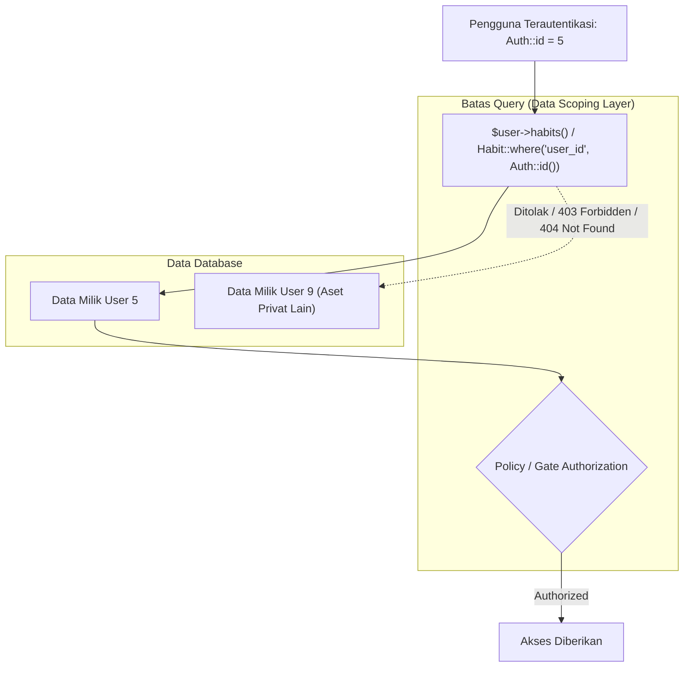

# Arsitektur Sistem — Mindstep Platform

> Status Dokumen: **Aktual** (Berdasarkan audit repositori per 29 Oktober 2026)  
> Referensi Dokumen Terkait: [`docs/DATABASE_SCHEMA.md`](./DATABASE_SCHEMA.md), [`docs/PAGE_PROPS_SPEC.md`](./PAGE_PROPS_SPEC.md), [`docs/DEVELOPMENT_GUIDE.md`](./DEVELOPMENT_GUIDE.md), [`docs/TESTING_GUIDE.md`](./TESTING_GUIDE.md)

---

## A. Gambaran Sistem

Mindstep adalah platform pengembangan diri (*self-development*) berbasis web yang menggabungkan pelacakan kebiasaan (*habit tracking*), pencatatan jurnal terstruktur dan bebas, pelacakan suasana hati (*mood tracking*), serta analisis korelasi data.

Arsitektur aplikasi mengadopsi pola **Modern Monolith**: satu *codebase* tunggal yang mengintegrasikan backend Laravel dan frontend React melalui jembatan Inertia.js tanpa memerlukan arsitektur API terpisah (seperti REST atau GraphQL) untuk konsumsi internal.

### Diagram Arsitektur Tingkat Tinggi

```mermaid
graph TD
    Client[Peramban Web / Browser Client]
    
    subgraph Frontend_React_TypeScript ["Frontend (React 18 + TypeScript + Tailwind CSS)"]
        InertiaAdapter["Inertia.js React Adapter (@inertiajs/react)"]
        Pages["Inertia Pages (resources/js/Pages)"]
        Layouts["Layouts (Authenticated & Guest)"]
        Components["Reusable UI Components"]
        InertiaForm["Form Handling (useForm)"]
    end

    subgraph Backend_Laravel ["Backend (Laravel Framework 13 / PHP 8.3)"]
        Router["HTTP Routing (routes/web.php & auth.php)"]
        MiddlewareStack["Middleware (auth, verified, HandleInertiaRequests)"]
        Controllers["Controllers (ProfileController, Auth Controllers)"]
        Requests["Form Requests (ProfileUpdateRequest, LoginRequest)"]
        EloquentModels["Eloquent Models (User, Habit, HabitLog, Journal, MoodLog, Tag)"]
    end

    subgraph Infrastructure_Layer ["Penyimpanan & Infrastruktur"]
        DB[(Database: MySQL / MariaDB / SQLite)]
        QueueJob["Queue Driver (database - jobs table)"]
        CacheStore["Cache Driver (database - cache table)"]
        SessionStore["Session Driver (database - sessions table)"]
    end

    Client -->|HTTP Request / XHR Inertia| Router
    Router --> MiddlewareStack
    MiddlewareStack --> Controllers
    Controllers --> Requests
    Controllers --> EloquentModels
    EloquentModels --> DB
    Controllers -->|Inertia::render(Component, Props)| InertiaAdapter
    InertiaAdapter --> Pages
    Pages --> Layouts
    Pages --> Components
    InertiaForm -->|POST / PUT / PATCH / DELETE| Router
    Backend_Laravel -.-> QueueJob
    Backend_Laravel -.-> CacheStore
    Backend_Laravel -.-> SessionStore
```

### Peran Komponen Utama Stack
* **Laravel Framework 13 (PHP 8.3)**: Mengelola logika bisnis backend, routing, autentikasi session, validasi server-side via Form Request, ORM Eloquent, migrasi database, dan scheduled background tasks.
* **Inertia.js v2 (`inertiajs/inertia-laravel` & `@inertiajs/react`)**: Menghilangkan kebutuhan routing API client-side. Controller langsung me-render halaman React dengan menyuntikkan data server melalui *page props*.
* **React 18 & TypeScript 5**: Menyediakan antarmuka pengguna berbasis komponen yang reaktif, *type-safe*, dan modular.
* **Tailwind CSS 3 + `@tailwindcss/forms`**: Menyediakan styling berbasis utilitas dengan dukungan mode gelap (*dark mode*) terintegrasi.
* **Database (MySQL / MariaDB / SQLite)**: Menyimpan entitas pengguna, kebiasaan, catatan log harian, jurnal, suasana hati, tag, serta state session dan queue jobs.
* **Layanan Antrean & Penjadwalan (Queue & Scheduler)**: Terkonfigurasi menggunakan database driver (`jobs`, `job_batches`, `failed_jobs`), disiapkan untuk kalkulasi streak dan agregasi data asinkron.
* **Layanan AI**: *Status: Belum diimplementasikan pada kode backend*. Rancangan integrasi eksternal (LLM API) akan membutuhkan lapisan service khusus dengan penjagaan *explicit consent*.

---

## B. Alur Request dan Data Inertia.js

Interaksi antara client dan server berjalan melalui satu siklus tertutup:

```mermaid
sequenceDiagram
    autonumber
    actor User as Pengguna (Browser)
    participant Route as Laravel Router
    participant Mid as HandleInertiaRequests Middleware
    participant Ctrl as Controller
    participant DB as Database (Eloquent)
    participant React as React Page (Inertia)

    User->>Route: Navigasi / Klik Tautan (Inertia Link)
    Route->>Mid: Jalankan pipeline middleware (Auth, Session)
    Mid->>Mid: Evaluasi share() (Props global: auth.user)
    Mid->>Ctrl: Teruskan Request ke Controller
    Ctrl->>DB: Query data via Model ber-scoping user_id
    DB-->>Ctrl: Koleksi data / Model instance
    Ctrl-->>User: Inertia::render('PageName', [props]) (JSON Response)
    Note over User,React: Inertia Client mengintersepsi JSON & me-render React Page
    User->>React: Update DOM secara halus tanpa reload halaman penuh
```



### Mekanisme Pengiriman Data
1. **Inertia Response**: Controller tidak mengembalikan view Blade mentah, melainkan memanggil `Inertia::render('Halaman', $data)`.
   ```php
   // Contoh aktual: app/Http/Controllers/ProfileController.php
   public function edit(Request $request): Response
   {
       return Inertia::render('Profile/Edit', [
           'mustVerifyEmail' => $request->user() instanceof MustVerifyEmail,
           'status' => session('status'),
       ]);
   }
   ```
2. **Shared Props (`HandleInertiaRequests`)**: Props global dibagikan otomatis ke seluruh halaman melalui method `share()` di `app/Http/Middleware/HandleInertiaRequests.php`:
   ```php
   public function share(Request $request): array
   {
       return [
           ...parent::share($request),
           'auth' => [
               'user' => $request->user(),
           ],
       ];
   }
   ```
   *Catatan Aktual*: Saat ini shared props hanya memuat objek `auth.user`. Flash messages (`success`, `error`) belum didaftarkan di method `share()`.
3. **Pemisahan State di Frontend**:
   * **Page Props**: Data awal dari server (bersifat read-only dari sudut pandang komponen).
   * **Local Component State (`useState`)**: State antarmuka lokal (misal: modal terbuka, tab aktif, dropdown).
   * **Form State (`useForm`)**: State khusus form yang mengelola nilai input, status pengiriman (`processing`), error validasi (`errors`), dan status mutasi (`recentlySuccessful`).
4. **Form Submission & Redirect**:
   * Pengguna mengisi form via `useForm`.
   * Request dikirim menggunakan method HTTP (`post`, `put`, `patch`, `delete`).
   * Controller memvalidasi input via Form Request, menjalankan mutasi data, dan mengembalikan `RedirectResponse` (contoh: `Redirect::route('profile.edit')`).
   * Inertia secara otomatis menangkap redirect 303 dan memperbarui props halaman target tanpa reload halaman penuh.

---

## C. Struktur Backend

Berdasarkan audit direktori `app/` dan `database/`:

| Direktori | Status Keberadaan | Tanggung Jawab Aktual / Rekomendasi |
| :--- | :--- | :--- |
| `app/Models` | **Aktual** | Representasi tabel database dan relasi Eloquent (`User`, `Habit`, `HabitLog`, `Journal`, `MoodLog`, `Tag`). Menggunakan PHP 8 attributes `#[Fillable]` dan casting tipe data. |
| `app/Http/Controllers` | **Aktual** | Menerima request HTTP, memanggil query/service, dan mengembalikan response Inertia. Saat ini berisi `ProfileController`, `Controller`, dan subdirektori `Auth/`. |
| `app/Http/Requests` | **Aktual** | Validasi input form berbasis Form Request (`ProfileUpdateRequest`, `Auth\LoginRequest`). |
| `app/Http/Middleware` | **Aktual** | Middleware pipeline, termasuk `HandleInertiaRequests.php` untuk root template dan shared props. |
| `app/Providers` | **Aktual** | Konfigurasi bootstrap layanan aplikasi (`AppServiceProvider.php`). |
| `app/Services` | **Belum diimplementasikan** *(Rekomendasi)* | Belum ada direktori ini. Direkomendasikan untuk logika kalkulasi streak habit, agregasi statistik analitik, dan integrasi prompt AI agar controller tetap ramping (*skinny controllers*). |
| `app/Policies` | **Belum diimplementasikan** *(Rekomendasi)* | Belum ada direktori ini. Otorisasi kepemilikan data saat ini masih mengandalkan filtering query langsung pada level model/controller. Direkomendasikan segera dibuat untuk `HabitPolicy`, `JournalPolicy`, dll. |
| `routes` | **Aktual** | Definisi route HTTP: `web.php` (aplikasi & dashboard), `auth.php` (autentikasi Breeze), `console.php` (perintah Artisan). |
| `database/migrations` | **Aktual** | Definisi skema tabel (`users`, `habits`, `habit_logs`, `journals`, `tags`, `mood_logs`, `journal_tag`, `jobs`, `cache`, `sessions`). |
| `database/factories` | **Aktual** | Factory data pengujian (`UserFactory`, `HabitFactory`, `HabitLogFactory`, `JournalFactory`, `MoodLogFactory`, `TagFactory`). *(Catatan: Definisi selain UserFactory masih kosong)*. |
| `database/seeders` | **Aktual** | Populasi data awal: `DatabaseSeeder.php` (membuat user uji dan 6 tag sistem bawaan). |
| `tests` | **Aktual** | Pengujian otomatis PHPUnit: `tests/Unit` dan `tests/Feature` (mencakup Auth, Profile, CoreModels, dan DatabaseIndexing). |

---

## D. Struktur Frontend

Berdasarkan audit direktori `resources/js`:

```text
resources/js/
├── Components/              # Komponen antarmuka atomik & molekuler
│   ├── ApplicationLogo.tsx  # Logo brand
│   ├── Checkbox.tsx         # Checkbox terkontrol
│   ├── DangerButton.tsx     # Tombol aksi bahaya/penghapusan
│   ├── Dropdown.tsx         # Menu dropdown reaktif
│   ├── InputError.tsx       # Tampilan pesan error validasi server
│   ├── InputLabel.tsx       # Label input form
│   ├── Modal.tsx            # Komponen dialog/popover modal
│   ├── NavLink.tsx          # Tautan navigasi desktop
│   ├── PrimaryButton.tsx    # Tombol aksi utama
│   ├── ResponsiveNavLink.tsx# Tautan navigasi responsif mobile
│   ├── SecondaryButton.tsx  # Tombol aksi sekunder
│   └── TextInput.tsx        # Bidang teks dengan forwardRef
├── Layouts/                 # Kerangka tampilan halaman
│   ├── AuthenticatedLayout.tsx # Layout pengguna login (header, nav bar, dropdown akun)
│   └── GuestLayout.tsx      # Layout tamu (halaman login, register, reset password)
├── Pages/                   # Halaman tampilan utama (Inertia Views)
│   ├── Auth/                # Halaman alur autentikasi Breeze (Login, Register, dll)
│   ├── Profile/             # Halaman profil & pengaturan akun (Edit.tsx, Partials/)
│   ├── Dashboard.tsx        # Dashboard utama (status: placeholder bawaan Breeze)
│   └── Welcome.tsx          # Halaman depan publik
├── types/                   # Definisi TypeScript global
│   ├── global.d.ts          # Deklarasi window, route helper Ziggy
│   ├── index.d.ts           # Antarmuka User dan PageProps dasar
│   └── vite-env.d.ts        # Deklarasi tipe Vite client
├── app.tsx                  # Titik masuk utama aplikasi React (createInertiaApp)
└── bootstrap.ts             # Inisialisasi dependensi frontend
```

*Catatan Struktur*:
* Direktori `resources/js/hooks` dan `resources/js/lib`: **Belum diimplementasikan**.
* Halaman khusus Habit (`Pages/Habits/`), Journal (`Pages/Journals/`), dan Analytics (`Pages/Insights/`): **Belum diimplementasikan** pada frontend saat audit dilakukan.

---

## E. Multi-Tenancy dan Data Scoping

Mindstep adalah platform privat *single-tenant instance with multi-user isolation*. Data jurnal, riwayat kebiasaan, dan catatan emosi bersifat konfidensial dan sensitif.



### Audit Kondisi Aktual
1. **Relasi Foreign Key `user_id`**: Seluruh tabel entitas (`habits`, `habit_logs`, `journals`, `mood_logs`, `tags`) memiliki kolom `user_id` yang terikat ke tabel `users` dengan `onDelete('cascade')`.
2. **Kueri Terikat Pengguna**: Pada model yang ada, akses data dilakukan melalui relasi pada objek `User` (contoh: `$user->habits`, `$user->journals`).
3. **Status Kebijakan Otorisasi (Laravel Policies)**: **Belum diimplementasikan**. Repositori belum memiliki file policy di `app/Policies`.
4. **Status Global Scopes**: **Belum diimplementasikan**. Tidak ada Global Scope yang otomatis menyuntikkan `where user_id = auth()->id()`.

### Risiko Keamanan IDOR (Insecure Direct Object Reference)
Tanpa Laravel Policy dan Route Model Binding yang ketat, terdapat potensi kerentanan di mana pengguna dapat menebak ID milik pengguna lain (misal: `GET /habits/12` atau `PATCH /journals/45`).

### Rekomendasi Penguatan Keamanan
1. **Buat Laravel Policy**: Implementasikan `HabitPolicy`, `JournalPolicy`, dan `MoodLogPolicy` yang memvalidasi bahwa `$user->id === $model->user_id`.
2. **Gunakan Scope Lokal**: Pasang trait atau scope lokal `scopeForUser($query, $userId)` pada model bisnis.
3. **Pertimbangan Global Scope**: Global Scope otomatis (`where('user_id', Auth::id())`) dapat mempermudah isolasi, namun memiliki risiko pada background jobs, task scheduler, atau seeder di mana konteks `Auth::id()` bernilai `null`. Disarankan menggunakan kombinasi Route Model Binding scoping (`Route::bind` atau policy eksplisit) daripada Global Scope implisit.

---

## F. Batas Tanggung Jawab Komponen

Berdasarkan pola yang ditetapkan dalam arsitektur Modern Monolith:

| Komponen | Tanggung Jawab Utama | Hal yang Dilarang |
| :--- | :--- | :--- |
| **Route (`web.php`)** | Mendaftarkan URI, menentukan method HTTP, memasang middleware otentikasi. | Menulis logika query database kompleks langsung di dalam closure route. |
| **Middleware** | Menyaring request sebelum mencapai controller (auth, verifikasi email, shared props Inertia). | Memodifikasi data bisnis atau menjalankan kalkulasi streak. |
| **Form Request** | Memvalidasi integritas input, tipe data, aturan unik, dan otorisasi dasar request. | Melakukan manipulasi database atau rendering halaman. |
| **Controller** | Orkestrasi alur request: menerima input tervalidasi, memanggil model/service, mengembalikan response Inertia. | Berisi puluhan baris algoritma statistik atau kalkulasi streak (*fat controller*). |
| **Eloquent Model** | Definisi skema tabel, casting tipe data, hubungan antar-tabel, scope query lokal. | Menangani input HTTP langsung atau memformat response UI. |
| **Service Layer** *(Rekomendasi)* | Menangani logika bisnis lintas-entitas (misal: algoritma streak, agregasi korelasi mood vs habit). | Berinteraksi langsung dengan session atau response HTTP Inertia. |
| **Laravel Policy** *(Rekomendasi)* | Memeriksa apakah user berhak melihat, mengedit, atau menghapus entitas tertentu. | Melakukan mutasi data. |
| **React Page** | Menerima data melalui props, menyusun struktur halaman, menghubungkan subkomponen. | Mengubah props secara langsung (*props mutation*). |
| **Reusable Component** | Menampilkan elemen visual murni (tombol, input, kartu) dan menerima callback event. | Melakukan request navigasi atau mutasi langsung tanpa kontrol parent. |

---

## G. Diagram Otorisasi dan Scoping Data

Diagram berikut mengilustrasikan jalur validasi request mutasi data untuk menjamin isolasi multi-user:

```mermaid
flowchart TD
    StartRequest([Request Masuk: PATCH /habits/:id]) --> CheckAuth{Apakah User Terautentikasi?}
    CheckAuth -- Tidak --> RedirectLogin[Redirect ke /login (HTTP 302)]
    CheckAuth -- Ya --> ValidateInput[Validasi Form Request]
    ValidateInput -- Validasi Gagal --> ReturnError[Redirect Back dengan Error Bag (HTTP 302/303)]
    ValidateInput -- Validasi Berhasil --> FindModel[Cari Habit berdasarkan :id]
    FindModel -- Tidak Ditemukan --> Return404[HTTP 404 Not Found]
    FindModel -- Ditemukan --> CheckPolicy{Apakah habit.user_id == auth.id?}
    CheckPolicy -- Tidak (Akses Ilegal) --> Return403[HTTP 403 Forbidden]
    CheckPolicy -- Ya (Sah) --> ExecuteAction[Jalankan Pembaruan Data via Model]
    ExecuteAction --> RedirectSuccess[Redirect ke Route Tujuan dengan Flash Message]
```
