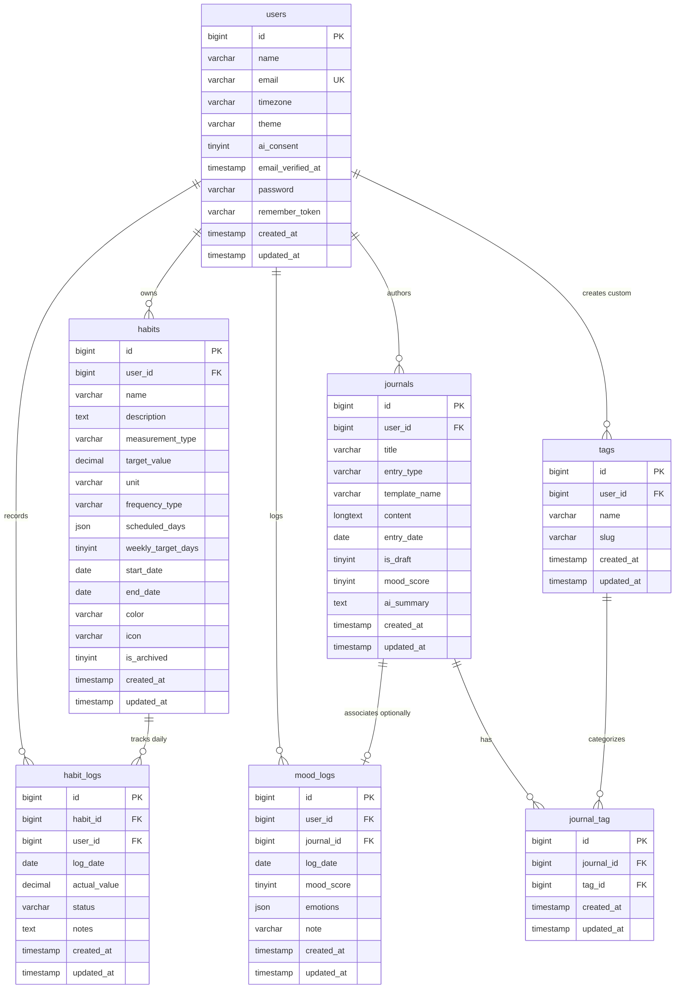

# Kamus Data & Skema Database — Mindstep Platform

> Status Dokumen: **Aktual** (Berdasarkan audit migrasi dan inspeksi skema database per 29 Oktober 2026)  
> Referensi Dokumen Terkait: [`docs/ARCHITECTURE.md`](./ARCHITECTURE.md), [`docs/PAGE_PROPS_SPEC.md`](./PAGE_PROPS_SPEC.md), [`docs/TESTING_GUIDE.md`](./TESTING_GUIDE.md)

---

## A. Diagram Entitas Relasi (ERD)

Diagram berikut merepresentasikan struktur tabel domain aplikasi yang telah dimigrasi dan diverifikasi pada database:

*Catatan Tabel Framework*:  
Selain tabel domain di atas, sistem memuat tabel bawaan Laravel untuk infrastruktur: `cache`, `cache_locks`, `jobs`, `job_batches`, `failed_jobs`, `sessions`, `migrations`, dan `password_reset_tokens`.

---

## B. Kamus Data Lengkap

### 1. Tabel: `users`
Menyimpan kredensial autentikasi pengguna, identitas dasar, dan preferensi akun.

| Kolom | Tipe Aktual (DB) | Nullable | Default | Key / Constraint | Keterangan |
| :--- | :--- | :--- | :--- | :--- | :--- |
| `id` | `bigint unsigned` | NO | *None* | PRIMARY KEY, AUTO_INCREMENT | Pengenal unik pengguna |
| `name` | `varchar(255)` | NO | *None* | - | Nama lengkap / tampilan pengguna |
| `email` | `varchar(255)` | NO | *None* | UNIQUE (`users_email_unique`) | Alamat email unik untuk login |
| `timezone` | `varchar(255)` | NO | `'UTC'` | - | Zona waktu IANA (misal: `Asia/Jakarta`) |
| `theme` | `varchar(20)` | NO | `'system'` | - | Tema UI (`light`, `dark`, `system`) |
| `ai_consent` | `tinyint(1)` | NO | `0` (false) | - | Persetujuan eksplisit pengiriman teks ke AI |
| `email_verified_at` | `timestamp` | YES | `NULL` | - | Waktu verifikasi email |
| `password` | `varchar(255)` | NO | *None* | - | Hash sandi Bcrypt |
| `remember_token` | `varchar(100)` | YES | `NULL` | - | Token sesi ingat saya |
| `created_at` | `timestamp` | YES | `NULL` | - | Waktu pendaftaran akun |
| `updated_at` | `timestamp` | YES | `NULL` | - | Waktu pembaruan profil |

---

### 2. Tabel: `habits`
Menyimpan konfigurasi kebiasaan harian, target kuantitatif, dan jadwal frekuensi.

| Kolom | Tipe Aktual (DB) | Nullable | Default | Key / Constraint | Keterangan |
| :--- | :--- | :--- | :--- | :--- | :--- |
| `id` | `bigint unsigned` | NO | *None* | PRIMARY KEY, AUTO_INCREMENT | Pengenal unik kebiasaan |
| `user_id` | `bigint unsigned` | NO | *None* | FOREIGN KEY (`users.id`), CASCADE | Pemilik kebiasaan |
| `name` | `varchar(255)` | NO | *None* | - | Nama aktivitas habit |
| `description` | `text` | YES | `NULL` | - | Deskripsi atau catatan motivasi |
| `measurement_type` | `varchar(20)` | NO | `'boolean'` | - | Tipe: `boolean`, `quantitative`, `duration` |
| `target_value` | `decimal(10,2)` | NO | `1.00` | - | Target kuantitas/durasi harian |
| `unit` | `varchar(50)` | YES | `NULL` | - | Satuan target (misal: `gelas`, `menit`, `halaman`) |
| `frequency_type` | `varchar(20)` | NO | `'daily'` | - | Jadwal: `daily`, `specific_days`, `weekly_target` |
| `scheduled_days` | `json` | YES | `NULL` | - | Array hari valid `[1, 2, ...]` (1=Senin, 7=Minggu) |
| `weekly_target_days` | `tinyint unsigned`| YES | `NULL` | - | Target frekuensi hari per minggu (misal: 4) |
| `start_date` | `date` | NO | *None* | - | Tanggal mulai efektif habit |
| `end_date` | `date` | YES | `NULL` | - | Batas akhir habit (opsional) |
| `color` | `varchar(30)` | NO | `'#4f46e5'` | - | Kode warna hex kartu habit di UI |
| `icon` | `varchar(50)` | YES | `NULL` | - | Nama identifier ikon Lucide |
| `is_archived` | `tinyint(1)` | NO | `0` (false) | - | Penanda status arsip |
| `created_at` | `timestamp` | YES | `NULL` | - | Waktu pembuatan entri |
| `updated_at` | `timestamp` | YES | `NULL` | - | Waktu pembaruan konfigurasi |

---

### 3. Tabel: `habit_logs`
Menyimpan catatan riwayat pelaksanaan kebiasaan per hari.

| Kolom | Tipe Aktual (DB) | Nullable | Default | Key / Constraint | Keterangan |
| :--- | :--- | :--- | :--- | :--- | :--- |
| `id` | `bigint unsigned` | NO | *None* | PRIMARY KEY, AUTO_INCREMENT | Pengenal unik log harian |
| `habit_id` | `bigint unsigned` | NO | *None* | FOREIGN KEY (`habits.id`), CASCADE | Kebiasaan yang dicatat |
| `user_id` | `bigint unsigned` | NO | *None* | FOREIGN KEY (`users.id`), CASCADE | Pengguna yang mencatat log |
| `log_date` | `date` | NO | *None* | - | Tanggal pelaksanaan aktivitas |
| `actual_value` | `decimal(10,2)` | NO | `0.00` | - | Nilai aktual yang berhasil diselesaikan |
| `status` | `varchar(20)` | NO | `'not_completed'` | - | Status: `not_completed`, `partial`, `completed`, `rest_day` |
| `notes` | `text` | YES | `NULL` | - | Catatan refleksi singkat log |
| `created_at` | `timestamp` | YES | `NULL` | - | Waktu pencatatan log |
| `updated_at` | `timestamp` | YES | `NULL` | - | Waktu pengubahan log |

---

### 4. Tabel: `journals`
Menyimpan naskah jurnal terstruktur maupun bebas.

| Kolom | Tipe Aktual (DB) | Nullable | Default | Key / Constraint | Keterangan |
| :--- | :--- | :--- | :--- | :--- | :--- |
| `id` | `bigint unsigned` | NO | *None* | PRIMARY KEY, AUTO_INCREMENT | Pengenal unik jurnal |
| `user_id` | `bigint unsigned` | NO | *None* | FOREIGN KEY (`users.id`), CASCADE | Pemilik jurnal |
| `title` | `varchar(255)` | YES | `NULL` | - | Judul entri jurnal (opsional) |
| `entry_type` | `varchar(20)` | NO | `'freeform'` | - | Tipe: `freeform` atau `template` |
| `template_name` | `varchar(255)` | YES | `NULL` | - | Nama template panduan yang dipilih |
| `content` | `longtext` | NO | *None* | - | Isi teks jurnal lengkap / serialisasi draf |
| `entry_date` | `date` | NO | *None* | - | Tanggal yang diasosiasikan dengan cerita |
| `is_draft` | `tinyint(1)` | NO | `0` (false) | - | Status: `1` (Draf), `0` (Terbit) |
| `mood_score` | `tinyint unsigned`| YES | `NULL` | - | Skala suasana hati numerik (1–5) |
| `ai_summary` | `text` | YES | `NULL` | - | Ringkasan reflektif yang disetujui pengguna |
| `created_at` | `timestamp` | YES | `NULL` | - | Waktu pembuatan entri |
| `updated_at` | `timestamp` | YES | `NULL` | - | Waktu pembaruan terakhir |

---

### 5. Tabel: `mood_logs`
Menyimpan catatan emosi terperinci harian (baik yang terikat ke jurnal maupun standalone).

| Kolom | Tipe Aktual (DB) | Nullable | Default | Key / Constraint | Keterangan |
| :--- | :--- | :--- | :--- | :--- | :--- |
| `id` | `bigint unsigned` | NO | *None* | PRIMARY KEY, AUTO_INCREMENT | Pengenal unik log mood |
| `user_id` | `bigint unsigned` | NO | *None* | FOREIGN KEY (`users.id`), CASCADE | Pemilik log mood |
| `journal_id` | `bigint unsigned` | YES | `NULL` | FOREIGN KEY (`journals.id`), NULL_ON_DELETE | Asosiasi ke entri jurnal terkait (opsional) |
| `log_date` | `date` | NO | *None* | - | Tanggal catatan emosi |
| `mood_score` | `tinyint unsigned`| NO | *None* | - | Nilai mood utama (1 sampai 5) |
| `emotions` | `json` | YES | `NULL` | - | Array label emosi spesifik `['Senang', 'Fokus']` |
| `note` | `varchar(500)` | YES | `NULL` | - | Catatan satu kalimat singkat |
| `created_at` | `timestamp` | YES | `NULL` | - | Waktu pencatatan |
| `updated_at` | `timestamp` | YES | `NULL` | - | Waktu penyuntingan |

---

### 6. Tabel: `tags`
Menyimpan label kategori topik (tersedia untuk sistem default maupun buatan user).

| Kolom | Tipe Aktual (DB) | Nullable | Default | Key / Constraint | Keterangan |
| :--- | :--- | :--- | :--- | :--- | :--- |
| `id` | `bigint unsigned` | NO | *None* | PRIMARY KEY, AUTO_INCREMENT | Pengenal unik tag |
| `user_id` | `bigint unsigned` | YES | `NULL` | FOREIGN KEY (`users.id`), CASCADE | `NULL` untuk tag default sistem, terisi untuk tag kustom |
| `name` | `varchar(255)` | NO | *None* | - | Nama tampilan tag (misal: `Pekerjaan`) |
| `slug` | `varchar(255)` | NO | *None* | - | Identifikasi URL / slug (misal: `pekerjaan`) |
| `created_at` | `timestamp` | YES | `NULL` | - | Waktu pembuatan tag |
| `updated_at` | `timestamp` | YES | `NULL` | - | Waktu pembaruan tag |

---

### 7. Tabel: `journal_tag`
Tabel pivot many-to-many antara jurnal dan tag.

| Kolom | Tipe Aktual (DB) | Nullable | Default | Key / Constraint | Keterangan |
| :--- | :--- | :--- | :--- | :--- | :--- |
| `id` | `bigint unsigned` | NO | *None* | PRIMARY KEY, AUTO_INCREMENT | Pengenal relasi |
| `journal_id` | `bigint unsigned` | NO | *None* | FOREIGN KEY (`journals.id`), CASCADE | Entri jurnal terkait |
| `tag_id` | `bigint unsigned` | NO | *None* | FOREIGN KEY (`tags.id`), CASCADE | Tag yang disematkan |
| `created_at` | `timestamp` | YES | `NULL` | - | Waktu relasi dibuat |
| `updated_at` | `timestamp` | YES | `NULL` | - | Waktu relasi diperbarui |

---

## C. Constraint dan Integritas Data

Audit terhadap constraint database yang aktif:

1. **Unique Constraint Habit Log Harian**:
   * Nama Constraint: `habit_logs_habit_id_log_date_unique`.
   * Kolom: `(habit_id, log_date)`.
   * Aturan: Menjamin satu kebiasaan tidak dapat memiliki lebih dari satu baris catatan pada tanggal yang sama. Operasi pencatatan berikutnya wajib berupa pembaruan (*upsert*).
2. **Unique Constraint Pivot Jurnal-Tag**:
   * Nama Constraint: `journal_tag_journal_id_tag_id_unique`.
   * Kolom: `(journal_id, tag_id)`.
   * Aturan: Mencegah penempelan tag yang sama lebih dari satu kali pada satu entri jurnal.
3. **Foreign Key Deletion Rules**:
   * **`CASCADE`**: Jika entitas induk dihapus (`users` atau `habits`), seluruh log riwayat (`habit_logs`), jurnal, dan tag terkait ikut terhapus bersih guna mematuhi hak privasi penghapusan akun (*Right to be Forgotten*).
   * **`SET NULL`**: Pada tabel `mood_logs.journal_id`, relasi dikonfigurasi `nullOnDelete()`. Jika entri jurnal dihapus, rekaman skor suasana hati dan emosi harian tetap tersimpan sebagai catatan *standalone*.
4. **Validasi Level Aplikasi vs Database**:
   * Rentang `mood_score` (1 sampai 5) saat ini ditegakkan di level form request / Eloquent model, bukan check constraint DB.

---

## D. Indeks dan Performa

Daftar seluruh indeks yang terpasang pada skema database beserta pola query yang dioptimalkannya:

| Tabel | Nama Indeks | Kolom yang Diindeks | Tipe Indeks | Tujuan & Pola Kueri yang Dioptimalkan |
| :--- | :--- | :--- | :--- | :--- |
| `users` | `PRIMARY` | `id` | B-TREE (Unique) | Lookup identitas pengguna |
| `users` | `users_email_unique` | `email` | B-TREE (Unique) | Otentikasi login & verifikasi duplikasi email |
| `habits` | `habits_user_archive_start_index` | `(user_id, is_archived, start_date)` | B-TREE (Composite) | Query Dashboard: Menyaring habit aktif milik user yang sudah mulai berjalan (`start_date <= today`) |
| `habits` | `habits_user_id_is_archived_index` | `(user_id, is_archived)` | B-TREE (Composite) | Menyaring daftar habit aktif vs daftar arsip |
| `habit_logs` | `habit_logs_habit_id_log_date_unique`| `(habit_id, log_date)` | B-TREE (Unique) | Pencegahan log ganda & lookup cepat status tanggal |
| `habit_logs` | `habit_logs_user_id_log_date_index` | `(user_id, log_date)` | B-TREE (Composite) | Agregasi dashboard: mengambil semua log user pada tanggal tertentu |
| `journals` | `journals_user_id_entry_date_index` | `(user_id, entry_date)` | B-TREE (Composite) | Tampilan kalender & riwayat linimasa kronologis |
| `journals` | `journals_user_id_is_draft_index` | `(user_id, is_draft)` | B-TREE (Composite) | Filter daftar draf jurnal yang belum dipublikasikan |
| `journals` | `journals_user_mood_index` | `(user_id, mood_score)` | B-TREE (Composite) | Filter pencarian jurnal berdasarkan nilai mood & agregasi analitik |
| `mood_logs` | `mood_logs_user_id_log_date_index` | `(user_id, log_date)` | B-TREE (Composite) | Grafik linimasa tren emosi mingguan/bulanan |
| `mood_logs` | `mood_logs_journal_id_foreign` | `journal_id` | B-TREE (Single) | Lookup mood log berdasarkan relasi jurnal |
| `tags` | `tags_user_id_slug_index` | `(user_id, slug)` | B-TREE (Composite) | Pencarian tag berdasarkan slug scoped ke user/sistem |
| `journal_tag` | `journal_tag_journal_id_tag_id_unique` | `(journal_id, tag_id)` | B-TREE (Unique) | Integritas relasi pivot |
| `journal_tag` | `journal_tag_tag_id_index` | `tag_id` | B-TREE (Single) | Filter jurnal terbalik berdasarkan tag tertentu (`WHERE tag_id = ?`) |

### Rekomendasi Indeks Masa Depan
1. **Full-Text Index pada `journals`**: Jika volume tulisan membesar, disarankan menambahkan index `FULLTEXT(title, content)` pada MySQL/PostgreSQL untuk fitur pencarian kata kunci cepat (FR-3.5) dibandingkan query `LIKE %...%`.
2. **Keterbatasan SQLite**: Full-text indexing pada SQLite membutuhkan modul FTS5 virtual table terpisah, sehingga perlu diisolasi agar tidak merusak suite test unit lokal.
