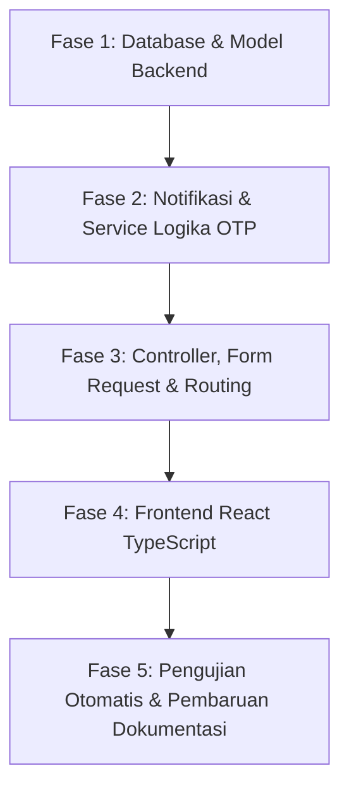

# Dokumen Rencana Implementasi: Modul Autentikasi, Preferensi Pengguna & Verifikasi Email OTP

> Nomor Dokumen: `PLAN-AUTH-001`  
> Tanggal: 29 Oktober 2026  
> Status: **Disetujui untuk Implementasi**  
> Target Branch: `feature/authentication-user(branch existing)`  
> Referensi: [`docs/prd.md`](../prd.md), [`docs/ARCHITECTURE.md`](../ARCHITECTURE.md), [`docs/DATABASE_SCHEMA.md`](../DATABASE_SCHEMA.md), [`docs/PAGE_PROPS_SPEC.md`](../PAGE_PROPS_SPEC.md), [`docs/TESTING_GUIDE.md`](../TESTING_GUIDE.md)

---

## 1. Ringkasan Eksekutif & Tujuan

Tujuan dari rencana ini adalah menyempurnakan subsistem autentikasi dan manajemen akun pada platform Mindstep agar sepenuhnya selaras dengan spesifikasi PRD Modul 7, meliputi:
1. **Email Verification via 6-Digit OTP**: Menggantikan atau melengkapi alur *signed URL link* dengan kode verifikasi 6 digit yang aman, berbatas waktu, dan memiliki perlindungan *brute-force* serta *resend throttling*.
2. **Pengaturan Preferensi Pengguna**: Melengkapi form profil agar pengguna dapat menyimpan `timezone` (IANA format), `theme` (`light`/`dark`/`system`), dan `ai_consent` (boolean).
3. **Manajemen Sesi Perangkat**: Memungkinkan pengguna melihat daftar sesi aktif pada tabel `sessions` dan mengeluarkan perangkat lain (*logout other browser sessions*).
4. **Penyelarasan Tipe Frontend**: Memperbarui antarmuka TypeScript `User` dan Form Request agar data mengalir sinkron dari database ke UI.

---

## 2. Arsitektur Data & Skema Database

### A. Migrasi Baru: `create_email_verifications_table.php`

Tabel `email_verifications` digunakan untuk menyimpan status OTP verifikasi secara aman dan terisolasi:

```sql
CREATE TABLE email_verifications (
    id BIGINT UNSIGNED AUTO_INCREMENT PRIMARY KEY,
    user_id BIGINT UNSIGNED NOT NULL,
    email VARCHAR(255) NOT NULL,
    otp_hash VARCHAR(64) NOT NULL,
    attempts TINYINT UNSIGNED NOT NULL DEFAULT 0,
    expires_at TIMESTAMP NOT NULL,
    created_at TIMESTAMP NULL,
    updated_at TIMESTAMP NULL,
    FOREIGN KEY (user_id) REFERENCES users(id) ON DELETE CASCADE,
    INDEX email_verifications_user_id_index (user_id),
    INDEX email_verifications_email_index (email)
);
```

#### Kebijakan Keamanan Data OTP:
* **Hashed Storage**: Kode 6 digit disimpan menggunakan `hash('sha256', $otp)`. Nilai *plaintext* hanya dikirimkan satu kali ke email pengguna.
* **TTL (Time to Live)**: OTP berlaku selama **15 menit** sejak dibuat.
* **Max Attempts**: Maksimal **5 kali** percobaan salah per kode OTP. Jika counter `attempts >= 5`, kode dibatalkan (*invalidated*).
* **Resend Cooldown**: Jeda waktu minimal **60 detik** sebelum pengguna dapat meminta pengiriman ulang OTP.

---

## 3. Rincian Pekerjaan Implementasi

Rencana implementasi dibagi menjadi 5 fase berurutan:



---

### Fase 1: Database & Model Backend

#### 1.1 Migrasi Tabel `email_verifications`
* Buat file migrasi via:
  ```bash
  php artisan make:migration create_email_verifications_table --no-interaction
  ```
* Kolom: `user_id`, `email`, `otp_hash`, `attempts`, `expires_at`, timestamps.
* Foreign key ke `users(id)` dengan `cascadeOnDelete()`.

#### 1.2 Model `app/Models/EmailVerification.php`
* Buat model Eloquent:
  ```bash
  php artisan make:model EmailVerification --no-interaction
  ```
* Atribut `#[Fillable(['user_id', 'email', 'otp_hash', 'attempts', 'expires_at'])]`.
* Casts: `'expires_at' => 'datetime'`, `'attempts' => 'integer'`.
* Relasi: `belongsTo(User::class)`.

#### 1.3 Relasi pada `app/Models/User.php`
* Tambahkan relasi `hasMany(EmailVerification::class)`.

---

### Fase 2: Notifikasi & Service Logika OTP

#### 2.1 Notifikasi Mailable: `app/Notifications/SendEmailOtpNotification.php`
* Buat notifikasi email:
  ```bash
  php artisan make:notification SendEmailOtpNotification --no-interaction
  ```
* Mengirim email berformat rapi berisi kode 6 digit numerik, informasi masa berlaku 15 menit, dan peringatan privasi untuk tidak membagikan kode ke siapa pun.

#### 2.2 Service / Helper Logika OTP
* Menghasilkan kode aman via `random_int(100000, 999999)`.
* Metode `generateOtp(User $user, string $email): string`:
  * Hapus atau tandai usang record OTP lama untuk user tersebut.
  * Buat baris baru di `email_verifications` dengan `hash('sha256', $code)` dan `expires_at = now()->addMinutes(15)`.
  * Kirim notifikasi `SendEmailOtpNotification`.
* Metode `verifyOtp(User $user, string $inputOtp): bool`:
  * Cari record aktif berdasarkan `user_id` dan `email`.
  * Cek kedaluwarsa (`expires_at < now()`).
  * Cek batas percobaan (`attempts >= 5`).
  * Bandingkan hash `hash_equals($record->otp_hash, hash('sha256', $inputOtp))`.
  * Jika cocok: update `users.email_verified_at = now()`, hapus record OTP.
  * Jika tidak cocok: increment `attempts`.

---

### Fase 3: Controller, Form Request & Routing

#### 3.1 Controller OTP: `app/Http/Controllers/Auth/EmailVerificationOtpController.php`
* **Method `notice(Request $request)`**:
  * Me-render halaman Inertia `Auth/VerifyEmailOtp`.
  * Mengirimkan props: `email`, `expiresInSeconds`, `canResendInSeconds` (dihitung dari created_at OTP terakhir + 60 detik).
* **Method `verify(VerifyOtpRequest $request)`**:
  * Memproses masukan kode 6 digit.
  * Jika berhasil: redirect ke `dashboard` dengan flash message sukses.
  * Jika gagal: redirect back dengan error bag `errors.otp`.
* **Method `resend(Request $request)`**:
  * Validasi *cooldown window* 60 detik.
  * Jika cooldown terpenuhi: generate kode baru, kirim email, redirect back dengan status info.

#### 3.2 Form Requests
* **`app/Http/Requests/Auth/VerifyOtpRequest.php`**:
  * Rules: `['otp' => ['required', 'string', 'digits:6']]`.
* **Perbarui `app/Http/Requests/ProfileUpdateRequest.php`**:
  * Tambahkan validasi untuk preferensi baru:
    ```php
    'timezone' => ['required', 'string', 'timezone:all'],
    'theme' => ['required', 'string', 'in:light,dark,system'],
    'ai_consent' => ['required', 'boolean'],
    ```

#### 3.3 Pembaruan `ProfileController.php`
* **Method `update()`**:
  * Menyimpan perubahan `name`, `email`, `timezone`, `theme`, `ai_consent`.
  * Jika email berubah: set `email_verified_at = null`, buat kode OTP baru, arahkan ke `verification.notice`.
* **Method `destroyOtherSessions(Request $request)`**:
  * Memvalidasi sandi saat ini (`current_password`).
  * Menghapus seluruh baris di tabel `sessions` milik user kecuali `session()->getId()`.

#### 3.4 Pendaftaran Route di `routes/auth.php`
* Sesuaikan rute verifikasi email agar mengarah ke controller OTP baru:
  * `GET /verify-email` -> `EmailVerificationOtpController@notice` (`verification.notice`).
  * `POST /verify-email/otp` -> `EmailVerificationOtpController@verify` (`verification.otp.verify`).
  * `POST /verify-email/resend` -> `EmailVerificationOtpController@resend` (`verification.otp.resend`).
* Daftarkan rute pembersihan sesi lain di `routes/web.php`:
  * `DELETE /profile/sessions` -> `ProfileController@destroyOtherSessions` (`profile.sessions.destroy`).

---

### Fase 4: Frontend React TypeScript

#### 4.1 Sinkronisasi Tipe TypeScript (`resources/js/types/index.d.ts`)
* Perbarui interface `User`:
  ```typescript
  export interface User {
      id: number;
      name: string;
      email: string;
      timezone: string;
      theme: 'light' | 'dark' | 'system';
      ai_consent: boolean;
      email_verified_at?: string;
  }
  ```

#### 4.2 Halaman Baru: `resources/js/Pages/Auth/VerifyEmailOtp.tsx`
* UI:
  * Kartu dialog terpusat dengan ikon amplop / surat.
  * Informasi email tujuan verifikasi.
  * 6 kotak input terpisah dengan fitur:
    * *Auto-focus next input* saat angka dimasukkan.
    * Dukungan *backspace* untuk kembali ke input sebelumnya.
    * Dukungan *paste* (menempelkan 6 digit sekaligus).
  * Tombol aksi "Verifikasi".
  * Tombol "Kirim Ulang Kode" dengan timer hitung mundur (*countdown*) 60 detik sebelum aktif kembali.
  * Tombol tautan "Keluar" (Logout).

#### 4.3 Pembaruan `resources/js/Pages/Profile/Partials/UpdateProfileInformationForm.tsx`
* Tambahkan input:
  1. **Dropdown Timezone**: Daftar zona waktu IANA standar (contoh: `Asia/Jakarta`, `Asia/Makassar`, `Asia/Jayapura`, `UTC`, dll).
  2. **Radio / Selector Tema**: Pilihan `light`, `dark`, atau `system`.
  3. **Toggle Switch AI Consent**: Keterangan jelas mengenai privasi dan tombol persetujuan fitur AI reflektif.

#### 4.4 Komponen Baru: `resources/js/Pages/Profile/Partials/ManageSessionsForm.tsx`
* Menampilkan daftar sesi browser aktif (IP address, user agent perangkat, waktu aktif terakhir).
* Tombol "Keluar dari Sesi Lain" dengan modal konfirmasi password.

---

### Fase 5: Pengujian Otomatis & Pembaruan Dokumentasi

#### 5.1 Suite Pengujian PHPUnit
Buat berkas uji feature:
* **`tests/Feature/Auth/EmailVerificationOtpTest.php`**:
  * Uji pengalihan user belum terverifikasi ke layar OTP.
  * Uji pengiriman kode OTP saat user baru mendaftar.
  * Uji keberhasilan verifikasi dengan kode 6 digit yang valid.
  * Uji penolakan kode OTP yang salah dan peningkatan nilai counter `attempts`.
  * Uji pemblokiran setelah 5 kali percobaan gagal berturut-turut.
  * Uji penolakan kode yang telah melewati batas kedaluwarsa 15 menit.
  * Uji pembatasan cooldown pengiriman ulang (60 detik).
* **`tests/Feature/ProfilePreferencesTest.php`**:
  * Uji keberhasilan penyimpanan preferensi `timezone`, `theme`, dan `ai_consent`.
  * Uji pergantian email yang otomatis me-reset `email_verified_at` dan memicu kode OTP baru.
  * Uji pemutusan sesi lain di tabel `sessions`.

#### 5.2 Pembaruan Dokumentasi Teknis
* Perbarui `docs/PAGE_PROPS_SPEC.md` (menambahkan rute OTP baru dan props `VerifyEmailOtp.tsx`).
* Perbarui `docs/DATABASE_SCHEMA.md` (menambahkan kamus data tabel `email_verifications`).
* Perbarui `docs/TESTING_GUIDE.md` (menandai skenario email verification sebagai *Covered*).

---

## 4. Matriks Risiko & Rencana Mitigasi

| Risiko Potensial | Dampak | Strategi Mitigasi |
| :--- | :--- | :--- |
| **Email Pengguna Belum Terkonfigurasi di Lokal** | Pengembang lokal gagal menerima kode OTP karena SMTP tidak aktif. | Konfigurasikan `MAIL_MAILER=log` secara default pada `.env.example`. Kode OTP akan otomatis tercatat pada `storage/logs/laravel.log` sehingga mudah dibaca saat pengujian lokal. |
| **Pengguna Mengubah Email Saat OTP Aktif** | Verifikasi email lama diterapkan ke email baru secara keliru. | Simpan kolom `email` di dalam baris `email_verifications`. Saat verifikasi dijalankan, pastikan `email_verifications.email === users.email`. |
| **Bypass Verifikasi Melalui Akses Rute Langsung** | Pengguna yang belum terverifikasi dapat mengakses modul habit/jurnal. | Pasang middleware `verified` pada seluruh kelompok rute privat di `routes/web.php`. |
| **Input OTP Tidak Responsif pada Layar Sentuh Mobile** | Pengguna kesulitan mengetik 6 kotak digit di smartphone. | Atur atribut `type="text" inputMode="numeric" pattern="[0-9]*"` pada masing-masing kotak input. |

---

## 5. Kriteria Penyelesaian (Definition of Done)

- [ ] Migrasi `email_verifications` berhasil dijalankan pada MySQL dan SQLite.
- [ ] Kode OTP 6 digit berhasil di-generate dan tersimpan dalam bentuk hash SHA-256.
- [ ] Form input OTP di `VerifyEmailOtp.tsx` berfungsi mulus (auto-focus, paste support, dan countdown timer 60 detik).
- [ ] Pengguna dapat menyimpan timezone, tema, dan toggle AI consent dari halaman Profil.
- [ ] Seluruh unit dan feature test di `EmailVerificationOtpTest` dan `ProfilePreferencesTest` lulus 100%.
- [ ] Pemformat kode `vendor/bin/pint --format agent` dan `npm run build` selesai tanpa kesalahan.
- [ ] Dokumentasi `docs/PAGE_PROPS_SPEC.md` dan `docs/DATABASE_SCHEMA.md` diperbarui.
